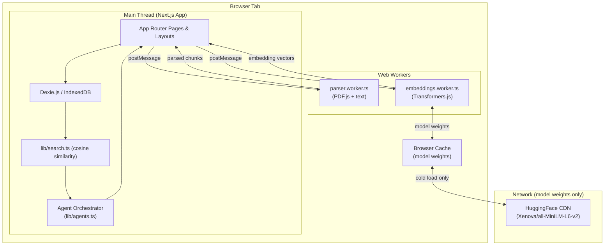
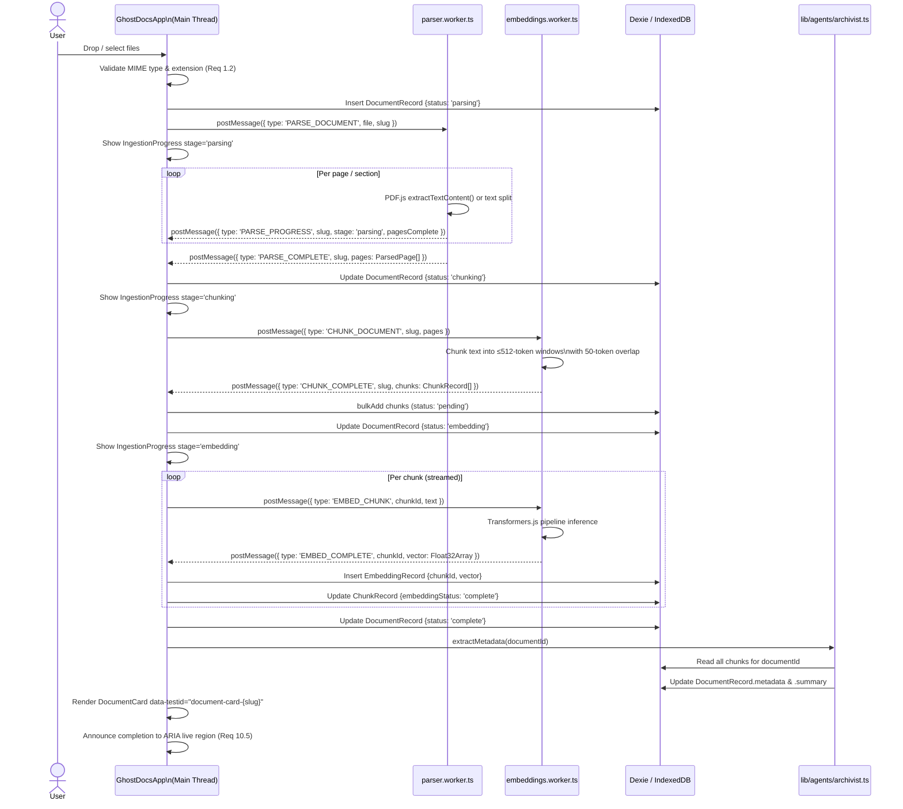
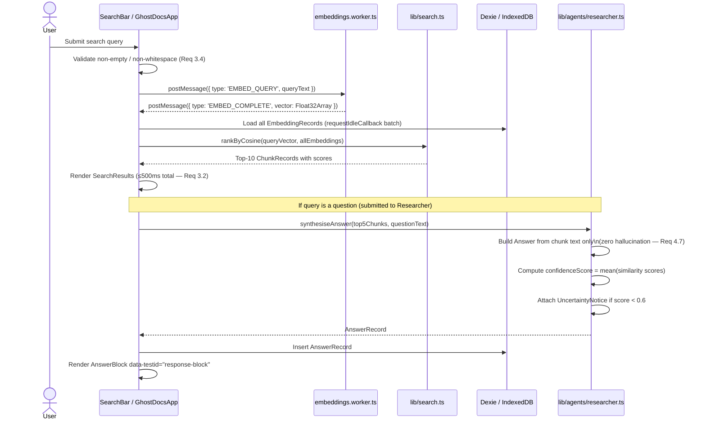
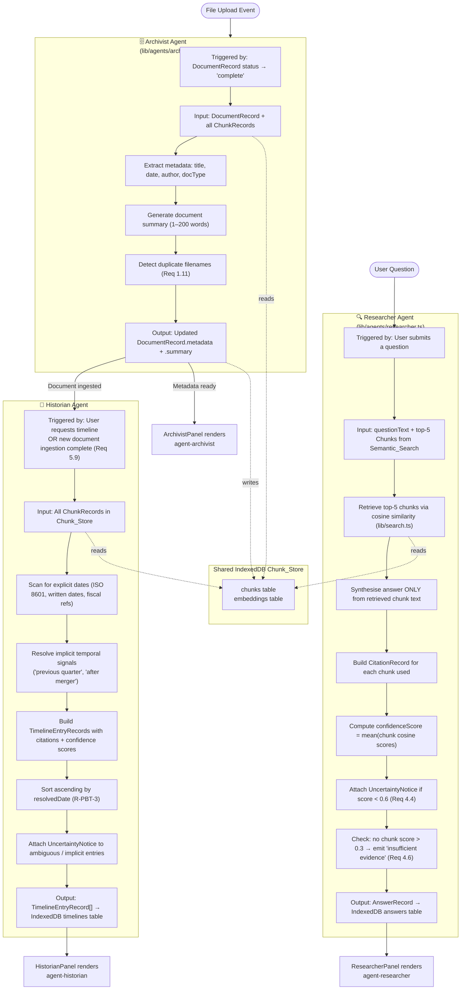

# Design Document

## Overview

GhostDocs is a fully browser-local application that ingests PDF, Markdown, and plain-text documents and exposes three named AI Crew agents — the Archivist, Historian, and Researcher — that collaboratively surface organisational knowledge through cited answers, chronological timelines, and semantic search. No document data ever leaves the browser.

The design is built on five architectural pillars:

1. **Static Next.js 15 export** (`output: 'export'`) — no server-side rendering of document content; the application is a pure client-side SPA deployed to any static host.
2. **Web Workers for all heavy processing** — PDF parsing, chunking, and Transformers.js embedding inference run in dedicated workers so the main thread is never blocked for more than 50 ms.
3. **IndexedDB via Dexie.js** — the single source of truth for all persistent state (documents, chunks, embeddings, timelines, answers, capsules), accessed only from the main thread or worker threads, never from API routes.
4. **Kiroween dark-mode-only theme** — a spooky-professional palette defined entirely as Tailwind `theme.extend` tokens, with WCAG AA contrast compliance and ≤ 200 ms entry transitions.
5. **Zero network leakage** — a Content Security Policy that blocks all non-model-weight network requests, Web Worker isolation, and no API routes that touch user document data.

### Key Design Goals vs. Requirements

| Design Goal | Requirement(s) |
|---|---|
| ≤ 50 ms main-thread block at any point | Req 1.4, Req 9.4 |
| 5 s ingestion for 10-page PDF | Req 1.12, Req 9.2 |
| 500 ms semantic search for ≤ 1,000 chunks | Req 3.2, Req 9.3 |
| Zero hallucination, mandatory citations | Req 4.2, Req 4.7 |
| WCAG AA throughout Kiroween theme | Req 10.1–10.7 |
| Zero network leakage of document data | Req 8.1–8.5 |

---

## Architecture

### High-Level System Architecture



### Next.js App Router Structure

The application is a single-page experience with a static shell. Server components handle only the static layout; all document-data components are client components.

```mermaid
graph TD
    RootLayout["app/layout.tsx\n(Server — applies dark class to html)"]
    HomePage["app/page.tsx\n(Server — static shell)"]
    
    subgraph ClientIsland["Client Component Island"]
        GhostDocsApp["components/ghostdocs/GhostDocsApp.tsx\n('use client' — root orchestrator)"]
        
        subgraph Upload["Upload Zone"]
            UploadZone["components/ghostdocs/UploadZone.tsx"]
            IngestionProgress["components/ghostdocs/IngestionProgress.tsx"]
        end
        
        subgraph DocumentPanel["Document Panel"]
            DocumentList["components/ghostdocs/DocumentList.tsx"]
            DocumentCard["components/ghostdocs/DocumentCard.tsx"]
            DeleteConfirmDialog["components/ghostdocs/DeleteConfirmDialog.tsx"]
        end
        
        subgraph SearchPanel["Search Panel"]
            SearchBar["components/ghostdocs/SearchBar.tsx"]
            SearchResults["components/ghostdocs/SearchResults.tsx"]
            SearchResultCard["components/ghostdocs/SearchResultCard.tsx"]
        end
        
        subgraph AgentPanels["Agent Panels"]
            ArchivistPanel["components/ghostdocs/ArchivistPanel.tsx"]
            HistorianPanel["components/ghostdocs/HistorianPanel.tsx"]
            ResearcherPanel["components/ghostdocs/ResearcherPanel.tsx"]
        end
        
        subgraph ResponseComponents["Response Components"]
            AnswerBlock["components/ghostdocs/AnswerBlock.tsx"]
            CitationBadge["components/ghostdocs/CitationBadge.tsx"]
            UncertaintyNotice["components/ghostdocs/UncertaintyNotice.tsx"]
            TimelineContainer["components/ghostdocs/TimelineContainer.tsx"]
            TimelineEntry["components/ghostdocs/TimelineEntry.tsx"]
        end
        
        subgraph CapsuleComponents["Time Capsule Components"]
            CapsuleControls["components/ghostdocs/CapsuleControls.tsx"]
        end
    end
    
    subgraph ShadcnUI["shadcn/ui Primitives (components/ui/)"]
        Button["Button"]
        Dialog["Dialog"]
        Progress["Progress"]
        Badge["Badge"]
        ScrollArea["ScrollArea"]
        Tooltip["Tooltip"]
        AlertDialog["AlertDialog"]
        Separator["Separator"]
    end

    RootLayout --> HomePage
    HomePage --> GhostDocsApp
    GhostDocsApp --> UploadZone
    GhostDocsApp --> DocumentList
    GhostDocsApp --> SearchBar
    GhostDocsApp --> AgentPanels
    GhostDocsApp --> CapsuleControls
    UploadZone --> IngestionProgress
    DocumentList --> DocumentCard
    DocumentCard --> DeleteConfirmDialog
    SearchResults --> SearchResultCard
    ResearcherPanel --> AnswerBlock
    AnswerBlock --> CitationBadge
    AnswerBlock --> UncertaintyNotice
    HistorianPanel --> TimelineContainer
    TimelineContainer --> TimelineEntry
    TimelineEntry --> UncertaintyNotice

    GhostDocsApp -.uses.-> Button
    GhostDocsApp -.uses.-> Dialog
    IngestionProgress -.uses.-> Progress
    CitationBadge -.uses.-> Badge
    DocumentList -.uses.-> ScrollArea
    CitationBadge -.uses.-> Tooltip
    DeleteConfirmDialog -.uses.-> AlertDialog
    AgentPanels -.uses.-> Separator
```



**Server vs. Client boundary rules:**
- `app/layout.tsx` and `app/page.tsx` are server components — they render static HTML shell only and never import browser APIs.
- All components under `components/ghostdocs/` are client components (`'use client'`), dynamically imported in `app/page.tsx` via `next/dynamic` with `{ ssr: false }` to prevent build-time SSR failures from IndexedDB and Web Worker APIs.
- shadcn/ui components in `components/ui/` are client components by default (Radix UI primitives require browser APIs).

---

## Components and Interfaces

### GhostDocsApp (Root Orchestrator)

The root client component. It owns the global application state and coordinates between the upload pipeline, agent panels, and search UI. It exposes no props (it reads all state from IndexedDB via Dexie hooks) and renders the full application layout.

**Responsibilities:**
- Instantiates and manages references to `parser.worker.ts` and `embeddings.worker.ts`.
- Subscribes to Dexie live queries for `documents`, `chunks`, and `timelines`.
- Routes incoming worker messages to the appropriate state handlers.
- Provides the ARIA live region for screen-reader announcements (Req 10.5).

### UploadZone

**Props:** `onFilesAccepted: (files: File[]) => void`  
**data-testid:** `upload-button` (drop zone / trigger), `upload-input` (hidden `<input type="file">`)

Handles drag-and-drop and file-picker interactions. Validates MIME types and extensions per Req 1.2 before calling `onFilesAccepted`. Renders inline errors (`data-testid="upload-error"`) for rejected files per Req 1.3. Does not initiate ingestion directly — delegates to the parent orchestrator.

### IngestionProgress

**Props:** `slug: string; stage: 'parsing' | 'chunking' | 'embedding' | 'complete' | 'error'`  
**data-testid:** `upload-progress` (generic), `ingestion-progress-{slug}` (per-document)

Displays the current ingestion stage as a labelled progress bar (shadcn `Progress`). Visible only while `stage !== 'complete'`.

### DocumentCard

**Props:** `document: DocumentRecord; onDelete: (slug: string) => void`  
**data-testid:** `document-card-{slug}`, `delete-document-{slug}`

Renders document metadata extracted by the Archivist. The delete control triggers `DeleteConfirmDialog`.

### SearchBar

**Props:** `onSearch: (query: string) => Promise<void>; isSearching: boolean`  
**data-testid:** `search-input`, `search-submit`

Validates that the query is non-empty and non-whitespace before calling `onSearch`. Displays inline error for empty/whitespace input per Req 3.4.

### AnswerBlock

**Props:** `answer: AnswerRecord`  
**data-testid:** `response-block`

Renders synthesised answer text, all citation badges, and an optional `UncertaintyNotice`. Each `CitationBadge` uses `data-testid="citation-{chunkId}"`.

### TimelineContainer

**Props:** `entries: TimelineEntry[]`  
**data-testid:** `timeline-container`

Renders a sorted list of `TimelineEntry` components. Entries are always sorted ascending by `resolvedDate` before render (enforces Req 5.2 and the chronological ordering invariant R-PBT-3).

### Agent Panels

Each panel wraps its agent-specific output, a loading indicator (`data-testid="agent-{name}-loading"`), and an error display (`data-testid="agent-{name}-error"`).

| Panel Component | data-testid | shadcn primitives |
|---|---|---|
| `ArchivistPanel` | `agent-archivist` | `Separator`, `Badge` |
| `HistorianPanel` | `agent-historian` | `Separator`, `ScrollArea` |
| `ResearcherPanel` | `agent-researcher` | `Separator`, `ScrollArea` |

### CapsuleControls

**data-testid:** `capsule-create-button`, `capsule-export-button`, `capsule-import-input`

Triggers Time Capsule creation, export serialisation, and import. Import uses a hidden `<input type="file">` that accepts `.json`.

---

## Data Models

### IndexedDB Schema (Dexie.js — `lib/db.ts`)

All tables are defined in a single `GhostDocsDB` class extending `Dexie`. Schema migrations are handled via Dexie version increments.

```typescript
// lib/db.ts
import Dexie, { type Table } from 'dexie';

// ─── Document ──────────────────────────────────────────────────────────────

export type DocumentStatus =
  | 'pending'
  | 'parsing'
  | 'chunking'
  | 'embedding'
  | 'complete'
  | 'error';

export type DocumentType = 'pdf' | 'markdown' | 'plaintext';

export interface DocumentMetadata {
  title: string | null;
  detectedDate: string | null;       // ISO 8601 string or null
  author: string | null;
  documentType: DocumentType;
}

export interface DocumentRecord {
  slug: string;                       // Primary key — URL-safe, stable identifier
  filename: string;
  mimeType: string;
  sizeBytes: number;
  status: DocumentStatus;
  metadata: DocumentMetadata;
  summary: string | null;            // Generated by the Archivist
  ingestedAt: number;                // Unix timestamp ms
  pageCount: number | null;          // PDFs only
  skippedPages: number[];            // Corrupt pages (Req 1.9)
  errorMessage: string | null;
}

// ─── Chunk ─────────────────────────────────────────────────────────────────

export type EmbeddingStatus = 'pending' | 'complete' | 'embedding_failed';

export interface ChunkRecord {
  chunkId: string;                   // Primary key — `${slug}-chunk-${index}`
  documentId: string;                // Foreign key → DocumentRecord.slug
  text: string;
  pageNumber: number | null;         // PDFs: 1-indexed page number
  lineOffset: number | null;         // Markdown/TXT: 0-indexed line of first token
  tokenCount: number;                // 1–512
  truncated: boolean;                // True if the chunk was truncated to 512 tokens
  chunkIndex: number;                // 0-indexed position within the document
  embeddingStatus: EmbeddingStatus;
}

// ─── Embedding ─────────────────────────────────────────────────────────────

export interface EmbeddingRecord {
  chunkId: string;                   // Primary key — matches ChunkRecord.chunkId
  vector: Float32Array;              // 384-dimensional (all-MiniLM-L6-v2 output)
}

// ─── Timeline Entry ────────────────────────────────────────────────────────

export interface CitationRecord {
  chunkId: string;
  documentName: string;
  pageNumber: number | null;
  lineSection: string | null;
  excerpt: string;                   // ≤ 50 words verbatim
}

export interface TimelineEntryRecord {
  entryId: string;                   // Primary key — UUID v4
  eventDescription: string;         // ≤ 500 characters
  resolvedDate: string | null;       // ISO 8601 or null for unresolved implicit signals
  resolvedDateEnd: string | null;    // ISO 8601 for date ranges
  confidenceScore: number;           // [0.0, 1.0]
  citations: CitationRecord[];
  uncertaintyNotice: string | null;  // Plain-language explanation when < fully confident
  isImplicit: boolean;               // True for unresolved temporal signals
  sessionId: string;                 // Groups entries by ingestion session
}

// ─── Answer ────────────────────────────────────────────────────────────────

export interface AnswerRecord {
  answerId: string;                  // Primary key — UUID v4
  questionText: string;
  synthesisedText: string;
  citations: CitationRecord[];
  confidenceScore: number;           // [0.0, 1.0] — arithmetic mean of chunk similarities
  uncertaintyNotice: string | null;
  createdAt: number;                 // Unix timestamp ms
  chunkIds: string[];                // The top-5 chunk IDs used for synthesis
}

// ─── Time Capsule ──────────────────────────────────────────────────────────

export interface CapsuleBundledData {
  documents: DocumentRecord[];
  chunks: ChunkRecord[];
  embeddings: Array<{ chunkId: string; vector: number[] }>;  // Float32Array → number[] for JSON
  timelineEntries: TimelineEntryRecord[];
}

export interface CapsuleRecord {
  capsuleId: string;                 // Primary key — UUID v4
  capsuleVersion: number;           // Positive integer, increments on breaking schema changes
  createdAt: number;                 // Unix timestamp ms
  documentCount: number;
  exportFilename: string;            // Default: ghostdocs-capsule-{YYYY-MM-DD}.json
  bundledData: CapsuleBundledData;
}

// ─── Database Class ────────────────────────────────────────────────────────

export class GhostDocsDB extends Dexie {
  documents!: Table<DocumentRecord, string>;
  chunks!: Table<ChunkRecord, string>;
  embeddings!: Table<EmbeddingRecord, string>;
  timelines!: Table<TimelineEntryRecord, string>;
  answers!: Table<AnswerRecord, string>;
  capsules!: Table<CapsuleRecord, string>;

  constructor() {
    super('GhostDocsDB');

    this.version(1).stores({
      documents: 'slug, status, ingestedAt',
      chunks: 'chunkId, documentId, embeddingStatus, chunkIndex',
      embeddings: 'chunkId',
      timelines: 'entryId, resolvedDate, sessionId, isImplicit',
      answers: 'answerId, createdAt',
      capsules: 'capsuleId, createdAt, capsuleVersion',
    });
  }
}

export const db = new GhostDocsDB();
```

**Schema notes:**
- `embeddings.vector` is stored as `Float32Array`. Dexie serialises typed arrays natively via the structured-clone algorithm — no manual conversion needed for storage. For JSON export in capsules, vectors are converted to `number[]`.
- The `chunks` table uses a compound secondary index on `[documentId+chunkIndex]` to support efficient ordered chunk retrieval per document.
- `timelines.resolvedDate` is indexed as a string in ISO 8601 format, enabling Dexie's `where('resolvedDate').below(...)` range queries for chronological sorting.
- Capsule imports check `slug` and `chunkId` uniqueness before writing (Req 2.3), implemented via Dexie transactions with `bulkPut` in "add" mode (rejects existing keys silently).

---

## Data Flow

### End-to-End Ingestion Pipeline



### Semantic Search Pipeline



---

## Multi-Agent Workflow

### Agent Coordination

The three agents share the IndexedDB Chunk_Store as their common knowledge base. They are not autonomous LLMs — they are deterministic orchestration functions in `lib/agents/` that:

1. Read from IndexedDB via Dexie queries.
2. Apply rule-based or vector-similarity-based logic to produce structured output.
3. Write results back to IndexedDB.
4. Emit typed events to the UI for rendering.

No agent makes external network calls. No agent uses a remote LLM API.



### Agent Trigger Conditions

| Agent | Trigger | Blocking? |
|---|---|---|
| Archivist | `DocumentRecord.status` transitions to `'complete'` | No — runs asynchronously after ingestion |
| Historian | User clicks "Generate Timeline" OR new document ingestion completes | No — debounced, runs in idle time |
| Researcher | User submits a question in the Researcher panel | No — async, shows loading indicator |

### Agent Isolation Rules

- Agents are pure TypeScript functions with no side effects beyond Dexie writes and UI event emissions.
- Agents do not call each other directly — they communicate via shared IndexedDB state.
- The Researcher depends on `lib/search.ts` (cosine similarity), not on the Archivist or Historian.
- The Historian depends only on the `chunks` table — it does not need Archivist metadata to generate a timeline.

---

## Correctness Properties

*A property is a characteristic or behavior that should hold true across all valid executions of a system — essentially, a formal statement about what the system should do. Properties serve as the bridge between human-readable specifications and machine-verifiable correctness guarantees.*

### Property 1: Citation Integrity Round-Trip

*For any* chunk C stored in the Chunk_Store and any Answer or TimelineEntry that cites C, the citation's `excerpt` field SHALL be a verbatim substring of `C.text`.

**Validates: Requirements 4.2, 4.9, 5.3, 5.8**

### Property 2: Confidence Score Range and Signal-Type Bounds

*For any* AnswerRecord or TimelineEntryRecord produced by any agent, the `confidenceScore` field SHALL satisfy `score >= 0.0 && score <= 1.0`. Additionally, *for any* TimelineEntryRecord derived exclusively from explicit date signals (ISO 8601, written dates, fiscal year references), `confidenceScore >= 0.8`; and *for any* TimelineEntryRecord derived exclusively from implicit temporal signals, `confidenceScore < 0.8`.

**Validates: Requirements 4.3, 5.7**

### Property 3: Chronological Ordering

*For any* non-empty array of TimelineEntryRecords sorted by the Historian, for any two adjacent entries E1 and E2 where E1 precedes E2 in the output array, `E1.resolvedDate <= E2.resolvedDate` (with null/implicit entries appearing after all resolved entries).

**Validates: Requirements 5.2, 5.6**

### Property 4: Cosine Similarity Range

*For any* pair of Float32Array vectors Q (query embedding) and C (chunk embedding), `cosineSimilarity(Q, C)` SHALL satisfy `-1.0 <= result <= 1.0`.

**Validates: Requirements 3.8**

### Property 5: Chunk Size Invariant

*For any* document of any length and any chunk produced from it by the chunker, the chunk's `tokenCount` SHALL satisfy `1 <= tokenCount <= 512`.

**Validates: Requirements 1.5**

### Property 6: Chunking Coverage Round-Trip

*For any* document text D, the multiset union of all chunk texts produced from D SHALL contain every non-whitespace character sequence present in D (no content loss across the chunking window and overlap).

**Validates: Requirements 1.5, 1.6**

### Property 7: Search Determinism

*For any* identical query string submitted twice against the same Chunk_Store state, the ranked result set (ordered list of chunkId + score pairs) SHALL be identical for both submissions.

**Validates: Requirements 3.9**

### Property 8: Zero Network Leakage

*For any* browser session in which one or more documents are present, no outbound network request SHALL carry document text, chunk text, or embedding vector data as part of its URL, request body, or headers.

**Validates: Requirements 8.2, 8.5**

### Property 9: Deletion Completeness

*For any* document D deleted from the Chunk_Store, every subsequent semantic search query SHALL return zero results whose `documentId` matches D's slug.

**Validates: Requirements 7.2, 7.4**

### Property 10: Low-Confidence Answers Include Uncertainty Notice

*For any* AnswerRecord produced by the Researcher where `confidenceScore < 0.6`, the `uncertaintyNotice` field SHALL be non-null and SHALL contain a plain-language explanation identifying one of: insufficient evidence, conflicting sources, date ambiguity, or partial coverage.

**Validates: Requirements 4.4**

### Property 11: Whitespace-Only Queries Are Rejected

*For any* string composed entirely of whitespace characters (including the empty string), submitting it as a search query SHALL result in no embedding being generated and no search being initiated; the search result state SHALL be unchanged.

**Validates: Requirements 3.4**

---

## Error Handling

### Upload & Ingestion Errors

| Condition | Handling | UI signal |
|---|---|---|
| Invalid MIME type / extension (Req 1.2–1.3) | Reject before ingestion; continue valid files | `data-testid="upload-error"` inline beneath drop zone |
| Password-protected PDF (Req 1.10) | Reject file; no ingestion | `data-testid="upload-error"` with password message |
| Corrupted PDF page (Req 1.9) | Skip page; continue ingestion | `data-testid="parse-warning-{slug}"` post-ingestion |
| Embedding failure for a chunk (Req 1.6) | Mark chunk `embedding_failed`; continue | `data-testid="embedding-warning-{chunkId}"` |
| Duplicate filename (Req 1.11) | Pause; prompt user | `data-testid="duplicate-confirm"` dialog |
| Parser_Worker crashes | Transition DocumentRecord to `status: 'error'`; log to console | `data-testid="agent-archivist-error"` |

### Agent Errors

All agent errors are caught at the orchestration layer (`lib/agents/`). Errors are:
1. Logged to the browser console with a structured context object (never to a remote endpoint).
2. Stored in `DocumentRecord.errorMessage` or emitted as a typed error event.
3. Rendered in the appropriate agent panel via `data-testid="agent-{name}-error"`.

Stack traces are never surfaced to the user UI (Req 6.7).

### Time Capsule Import Errors

| Condition | Handling |
|---|---|
| Malformed JSON (Req 2.4) | Abort; display plain-language parse error; zero IndexedDB writes |
| Schema validation failure (Req 2.4) | Abort; display field-level error message |
| `capsuleVersion` > current max (Req 2.6) | Abort; display "requires newer app version" message |
| Duplicate `chunkId` / `slug` on import (Req 2.3) | Skip silently; report skipped count to user |

### Worker Communication Errors

Workers use a typed message protocol with explicit error message types (`PARSE_ERROR`, `EMBED_ERROR`). If a worker fails to respond within 10 seconds to an `EMBED_QUERY` message, the Researcher emits an error state per Req 4.10. Worker instantiation failures (missing script, out-of-memory) are caught in the `worker.onerror` handler and escalate to the agent panel error display.

---

## Web Worker Typed Message Protocol

### `workers/types.ts`

```typescript
// workers/types.ts
// Shared discriminated union types for all worker ↔ main-thread communication.

// ─── Parser Worker Protocol ────────────────────────────────────────────────

export interface ParseDocumentRequest {
  type: 'PARSE_DOCUMENT';
  slug: string;
  fileName: string;
  mimeType: string;
  buffer: ArrayBuffer;       // Transferred via Transferable — zero-copy
}

export interface ParseProgressMessage {
  type: 'PARSE_PROGRESS';
  slug: string;
  pagesComplete: number;
  totalPages: number;
  stage: 'parsing';
}

export interface ParsedPage {
  pageNumber: number;        // 1-indexed; null for non-PDF sources
  lineOffset: number;        // 0-indexed line number of first character
  text: string;
}

export interface ParseCompleteMessage {
  type: 'PARSE_COMPLETE';
  slug: string;
  pages: ParsedPage[];
  pageCount: number | null;
  skippedPages: number[];
}

export interface ParseErrorMessage {
  type: 'PARSE_ERROR';
  slug: string;
  errorCode: 'PASSWORD_PROTECTED' | 'CORRUPTED' | 'UNSUPPORTED_FORMAT' | 'UNKNOWN';
  message: string;
}

// Inbound (main → parser worker)
export type ParserWorkerRequest = ParseDocumentRequest;

// Outbound (parser worker → main)
export type ParserWorkerMessage =
  | ParseProgressMessage
  | ParseCompleteMessage
  | ParseErrorMessage;

// ─── Embeddings Worker Protocol ────────────────────────────────────────────

export interface ChunkDocumentRequest {
  type: 'CHUNK_DOCUMENT';
  slug: string;
  pages: ParsedPage[];
  maxTokens: 512;
  overlapTokens: 50;
}

export interface ChunkCompleteMessage {
  type: 'CHUNK_COMPLETE';
  slug: string;
  chunks: Array<{
    chunkId: string;
    text: string;
    pageNumber: number | null;
    lineOffset: number | null;
    tokenCount: number;
    truncated: boolean;
    chunkIndex: number;
  }>;
}

export interface EmbedChunkRequest {
  type: 'EMBED_CHUNK';
  chunkId: string;
  text: string;
}

export interface EmbedQueryRequest {
  type: 'EMBED_QUERY';
  requestId: string;         // UUID — correlates async request to response
  queryText: string;
}

export interface EmbedCompleteMessage {
  type: 'EMBED_COMPLETE';
  chunkId?: string;          // Set for chunk embeddings
  requestId?: string;        // Set for query embeddings
  vector: Float32Array;      // Transferred via Transferable
}

export interface EmbedErrorMessage {
  type: 'EMBED_ERROR';
  chunkId?: string;
  requestId?: string;
  message: string;
}

export interface ModelLoadProgressMessage {
  type: 'MODEL_LOAD_PROGRESS';
  progress: number;          // 0–100
  status: 'loading' | 'ready';
}

// Inbound (main → embeddings worker)
export type EmbeddingsWorkerRequest =
  | ChunkDocumentRequest
  | EmbedChunkRequest
  | EmbedQueryRequest;

// Outbound (embeddings worker → main)
export type EmbeddingsWorkerMessage =
  | ChunkCompleteMessage
  | EmbedCompleteMessage
  | EmbedErrorMessage
  | ModelLoadProgressMessage;
```

**Transferable usage:** `ArrayBuffer` (file content) and `Float32Array` (embedding vectors) are transferred via the structured-clone `transfer` list to avoid copying large binary data across the worker boundary.

**Request correlation:** Query embedding requests use a `requestId` UUID so that concurrent searches (a user resubmitting quickly) can be matched to their correct response without a FIFO assumption.

---

## Security and Privacy Architecture

### Zero Network Leakage Enforcement

The privacy-first guarantee (Req 8.1–8.5, R-PBT-7) is enforced at three independent layers:

#### Layer 1: Content Security Policy

`next.config.ts` sets the following CSP headers on all responses (via `headers()` in development and via `public/_headers` for static hosting):

```
Content-Security-Policy:
  default-src 'self';
  script-src 'self' 'wasm-unsafe-eval';
  connect-src 'self' https://huggingface.co https://cdn-lfs.huggingface.co;
  worker-src 'self' blob:;
  img-src 'self' data: blob:;
  style-src 'self' 'unsafe-inline';
  font-src 'self';
  object-src 'none';
  base-uri 'self';
  frame-ancestors 'none';
```

`connect-src` permits only HuggingFace CDN (model weights) and `'self'`. Document text, chunks, and embeddings are never sent there — the HuggingFace CDN is only contacted to fetch model binary files, not to send data.

`wasm-unsafe-eval` is required for Transformers.js WASM inference. This is a known and accepted tradeoff — it does not permit arbitrary code execution beyond WASM modules already loaded from `'self'`.

#### Layer 2: Web Worker Isolation

Workers are instantiated with `new Worker(new URL('../workers/...', import.meta.url))` — they share no globals with the main thread beyond the message channel. Workers cannot access the DOM, `localStorage`, or make arbitrary `fetch` calls because:
- They have no `document` or `window` globals.
- Their `fetch` capability is restricted by the same CSP `connect-src` directive.

The embeddings worker only contacts HuggingFace CDN for model weight files during the initial cold load. Thereafter it operates fully offline (Req 8.4).

#### Layer 3: No API Routes for Document Data

The Next.js app uses `output: 'export'`, which means **no API routes are deployed**. There is no server-side code path that could receive document data even accidentally.

Any developer who adds an `app/api/` route that touches document data will receive a build-time error from the static export configuration (`getStaticProps` / `generateStaticParams` cannot read IndexedDB).

### Playwright Network Interception Strategy (R-PBT-7)

E2E tests verify zero network leakage by intercepting all requests:

```typescript
// tests/e2e/privacy.spec.ts (implementation reference)
test('no document data in network requests', async ({ page }) => {
  const leakedRequests: string[] = [];
  
  // Upload a document with a known distinctive phrase
  const CANARY = 'ghostdocs-canary-secret-phrase-xq7z';
  
  page.on('request', (request) => {
    const body = request.postData() ?? '';
    const url = request.url();
    const headers = JSON.stringify(request.headers());
    if (
      body.includes(CANARY) ||
      url.includes(CANARY) ||
      headers.includes(CANARY)
    ) {
      leakedRequests.push(url);
    }
  });

  // Upload synthetic document containing CANARY phrase
  // ... upload flow ...
  
  // Perform search and answer generation
  await page.getByTestId('search-input').fill(CANARY);
  await page.getByTestId('search-submit').click();
  
  expect(leakedRequests).toHaveLength(0);
});
```

---

## Kiroween Theme Design Tokens

### `tailwind.config.ts` — `theme.extend`

```typescript
// tailwind.config.ts
import type { Config } from 'tailwindcss';

const config: Config = {
  darkMode: 'class',
  content: [
    './app/**/*.{ts,tsx}',
    './components/**/*.{ts,tsx}',
  ],
  theme: {
    extend: {
      colors: {
        // ── Base Backgrounds ──────────────────────────────────────────
        'ghost-void':     '#0a0a0f',  // Deepest background — html/body
        'ghost-crypt':    '#12121a',  // Card & panel backgrounds
        'ghost-tomb':     '#1a1a28',  // Elevated surface (modals, tooltips)
        'ghost-mist':     '#242438',  // Hover states, subtle borders

        // ── Midnight Purples ──────────────────────────────────────────
        'specter-900':    '#1e0a3c',
        'specter-800':    '#2d1060',
        'specter-700':    '#3d1880',
        'specter-600':    '#5424a8',
        'specter-500':    '#7b3fd4',  // Primary interactive purple
        'specter-400':    '#9d6de0',
        'specter-300':    '#bfa0ec',  // Focus rings, active states
        'specter-200':    '#dcc8f5',
        'specter-100':    '#f0e8fc',

        // ── Muted Teals (secondary accent) ───────────────────────────
        'ectoplasm-900':  '#062020',
        'ectoplasm-800':  '#0a3535',
        'ectoplasm-700':  '#0f4f4f',
        'ectoplasm-600':  '#156e6e',
        'ectoplasm-500':  '#1e9090',  // Secondary interactive teal
        'ectoplasm-400':  '#38b4b4',
        'ectoplasm-300':  '#6cd0d0',
        'ectoplasm-200':  '#a8e6e6',
        'ectoplasm-100':  '#d8f5f5',

        // ── Ghost Glow (amber/orange accent) ─────────────────────────
        'glow-600':       '#7a3a00',
        'glow-500':       '#b05800',
        'glow-400':       '#e07a10',  // Primary amber glow
        'glow-300':       '#f0a030',  // Hover ghost glow
        'glow-200':       '#f5c870',
        'glow-100':       '#fde8b0',

        // ── Charcoal Text Scale ───────────────────────────────────────
        'parchment-900':  '#e8e4dc',  // Primary body text (contrast ≥4.5:1 on ghost-crypt)
        'parchment-700':  '#c4bfb5',  // Secondary text
        'parchment-500':  '#8a857a',  // Muted / placeholder text
        'parchment-300':  '#4a4640',  // Disabled text (decorative only)

        // ── Semantic ──────────────────────────────────────────────────
        'shade-error':    '#e05050',  // Error states
        'shade-warn':     '#d49020',  // Warning states
        'shade-success':  '#38a878',  // Success states
      },

      boxShadow: {
        // Ghost-glow halo for highlighted elements
        'glow-sm':   '0 0 8px 1px rgba(224, 122, 16, 0.25)',
        'glow-md':   '0 0 16px 3px rgba(224, 122, 16, 0.35)',
        'glow-lg':   '0 0 32px 6px rgba(224, 122, 16, 0.30)',
        // Specter inner glow for panels
        'specter-sm': '0 0 8px 2px rgba(123, 63, 212, 0.20)',
        'specter-md': '0 0 20px 4px rgba(123, 63, 212, 0.25)',
        // Depth shadows for elevated surfaces
        'crypt-sm':  '0 2px 8px 0 rgba(0, 0, 0, 0.60)',
        'crypt-md':  '0 4px 20px 0 rgba(0, 0, 0, 0.70)',
        'crypt-lg':  '0 8px 40px 0 rgba(0, 0, 0, 0.80)',
      },

      backgroundImage: {
        // Parchment texture overlay for document cards (CSS noise pattern)
        'parchment-texture': "url(\"data:image/svg+xml,%3Csvg xmlns='http://www.w3.org/2000/svg' width='200' height='200'%3E%3Cfilter id='noise'%3E%3CfeTurbulence type='fractalNoise' baseFrequency='0.65' numOctaves='3' stitchTiles='stitch'/%3E%3CfeColorMatrix type='saturate' values='0'/%3E%3C/filter%3E%3Crect width='200' height='200' filter='url(%23noise)' opacity='0.04'/%3E%3C/svg%3E\")",
        // Fog gradient for page background
        'fog-radial': 'radial-gradient(ellipse 80% 50% at 50% 0%, rgba(61,24,128,0.15) 0%, transparent 70%)',
      },

      keyframes: {
        // Primary entry transition — ghostly fade-up
        'ghost-appear': {
          '0%':   { opacity: '0', transform: 'translateY(6px)' },
          '100%': { opacity: '1', transform: 'translateY(0)' },
        },
        // Shimmer hover effect for interactive cards
        'shimmer': {
          '0%':   { backgroundPosition: '-200% center' },
          '100%': { backgroundPosition: '200% center' },
        },
        // Pulse glow for loading states
        'glow-pulse': {
          '0%, 100%': { boxShadow: '0 0 8px 1px rgba(224, 122, 16, 0.2)' },
          '50%':       { boxShadow: '0 0 20px 4px rgba(224, 122, 16, 0.45)' },
        },
        // Floating animation for decorative ghost elements
        'float': {
          '0%, 100%': { transform: 'translateY(0)' },
          '50%':       { transform: 'translateY(-6px)' },
        },
      },

      animation: {
        // ≤200ms per Kiroween motion principle (Req 10.6)
        'ghost-appear':  'ghost-appear 150ms ease-out both',
        'ghost-appear-slow': 'ghost-appear 200ms ease-out both',
        'shimmer':       'shimmer 2s linear infinite',
        'glow-pulse':    'glow-pulse 2s ease-in-out infinite',
        'float':         'float 4s ease-in-out infinite',
      },

      transitionDuration: {
        '150': '150ms',
      },
    },
  },
  plugins: [],
};

export default config;
```

### `prefers-reduced-motion` Compliance (Req 10.7)

All animation and transition classes are wrapped in `motion-safe:` variants in Tailwind, or the global stylesheet includes:

```css
/* styles/globals.css */
@media (prefers-reduced-motion: reduce) {
  *, *::before, *::after {
    animation-duration: 0.01ms !important;
    animation-iteration-count: 1 !important;
    transition-duration: 0.01ms !important;
  }
}
```

### WCAG AA Contrast Verification

| Text colour | Background | Ratio | Passes AA? |
|---|---|---|---|
| `parchment-900` (#e8e4dc) | `ghost-crypt` (#12121a) | ~13.2:1 | ✅ body text |
| `parchment-700` (#c4bfb5) | `ghost-crypt` (#12121a) | ~9.8:1 | ✅ secondary text |
| `specter-300` (#bfa0ec) | `ghost-crypt` (#12121a) | ~7.1:1 | ✅ interactive labels |
| `glow-400` (#e07a10) | `ghost-void` (#0a0a0f) | ~5.2:1 | ✅ accent text |
| `ectoplasm-300` (#6cd0d0) | `ghost-crypt` (#12121a) | ~8.4:1 | ✅ secondary accent |

---

## Performance Architecture

### Main-Thread Budget Enforcement (≤ 50 ms)

Req 9.4 requires the main thread never blocks for more than 50 ms during ingestion, embedding, or search.

**Strategy 1 — Web Worker offloading (primary)**  
All CPU-intensive work runs in `parser.worker.ts` and `embeddings.worker.ts`. The main thread only:
- Posts messages to workers (`O(1)` — immediate).
- Receives results and writes to Dexie (`O(chunk count)` batched via `bulkAdd`).
- Runs cosine similarity in `lib/search.ts`.

Cosine similarity across 1,000 chunks requires ~1,000 dot products over 384-dimension vectors = ~384,000 multiplications. Benchmarks show this completes in ~20–80 ms on mid-range CPUs. For stores approaching the upper bound (1,000 chunks), the search is split into batches using `requestIdleCallback`:

```typescript
// lib/search.ts — batch cosine search with rIC
async function rankByCosine(
  query: Float32Array,
  embeddings: EmbeddingRecord[],
  batchSize = 100
): Promise<RankedChunk[]> {
  const scores: RankedChunk[] = [];
  for (let i = 0; i < embeddings.length; i += batchSize) {
    await new Promise<void>((resolve) =>
      requestIdleCallback(() => {
        const batch = embeddings.slice(i, i + batchSize);
        for (const emb of batch) {
          scores.push({ chunkId: emb.chunkId, score: cosine(query, emb.vector) });
        }
        resolve();
      }, { timeout: 50 })
    );
  }
  return scores.sort((a, b) => b.score - a.score).slice(0, 10);
}
```

**Strategy 2 — Streaming chunk embedding**  
Rather than sending all chunks to the worker at once, chunks are submitted for embedding one at a time (or in small batches of 10) via `postMessage`. This prevents the main-thread message handler from processing a single enormous response that causes a jank spike.

**Strategy 3 — Dexie bulk operations**  
All IndexedDB writes use `db.chunks.bulkAdd()` and `db.embeddings.bulkAdd()` rather than individual `add()` calls. Bulk operations execute in a single IndexedDB transaction, dramatically reducing the number of main-thread event loop ticks consumed.

### Model Weight Caching

The Transformers.js library caches model weights automatically in the [Cache API](https://developer.mozilla.org/en-US/docs/Web/API/Cache) (via `env.cacheDir`). On cold load:

1. The embeddings worker requests weights from HuggingFace CDN (~23 MB for `all-MiniLM-L6-v2`).
2. The browser caches the response.
3. Subsequent loads serve from cache with zero network latency.

The worker emits `MODEL_LOAD_PROGRESS` messages during the cold load, which the UI displays as a model initialisation progress bar. After the model is ready, the worker emits `{ type: 'MODEL_LOAD_PROGRESS', progress: 100, status: 'ready' }` and the progress bar is dismissed.

### Large PDF Ingestion — Chunked Streaming

For PDFs exceeding ~5 pages, parsing is streamed page-by-page rather than extracting all pages before returning. The parser worker sends `PARSE_PROGRESS` messages after each page, allowing the UI to update the ingestion stage indicator continuously (Req 1.7). This prevents a perceived freeze during large document parsing and keeps the `upload-progress` indicator accurate.

The embedding phase uses a sliding window approach: as soon as 10 chunks are ready, they are submitted to the embeddings worker while parsing continues. This pipeline overlap means embedding begins before the full document is chunked, reducing total wall-clock ingestion time.

### Performance Targets Summary

| Operation | Target | Enforcement mechanism |
|---|---|---|
| First Contentful Paint (cold) | ≤ 3 s | Static export + no SSR; dynamic import of heavy client components |
| 10-page PDF ingestion | ≤ 5 s | Streaming parse + parallel embed pipeline; Web Workers |
| Semantic search (≤ 1,000 chunks) | ≤ 500 ms | requestIdleCallback batching; Float32Array cosine dot product |
| Main thread block | ≤ 50 ms | Web Workers for all CPU work; rIC for cosine batching |
| UI response during embedding | ≤ 100 ms | Embedding runs in worker; main thread free for input events |

---

## Testing Strategy

### Unit Tests (Vitest — `tests/unit/`)

Pure logic modules in `lib/` are tested with Vitest. Property-based tests use [fast-check](https://github.com/dubzzz/fast-check), configured to run 100 iterations per property.

**Modules covered:**

| Module | Test type | Property reference |
|---|---|---|
| `lib/chunker.ts` | Property-based | Properties 5, 6 |
| `lib/search.ts` (cosine) | Property-based | Properties 4, 7 |
| `lib/agents/historian.ts` (sort) | Property-based | Property 3 |
| `lib/agents/researcher.ts` (citation build) | Property-based | Properties 1, 2 |
| `lib/agents/researcher.ts` (confidence score) | Property-based | Property 2 |
| `lib/db.ts` (slug derivation) | Unit examples | — |
| `lib/capsule.ts` (export/import round-trip) | Unit examples | — |

**Property test configuration (fast-check):**

```typescript
// tests/unit/chunker.test.ts — example property test
import { fc } from 'fast-check';
import { chunkText } from '../../lib/chunker';

// Feature: ghostdocs-master, Property 5: Chunk size invariant
test('every chunk has 1 ≤ tokenCount ≤ 512', () => {
  fc.assert(
    fc.property(fc.string({ minLength: 1, maxLength: 50000 }), (text) => {
      const chunks = chunkText(text, 512, 50);
      return chunks.every((c) => c.tokenCount >= 1 && c.tokenCount <= 512);
    }),
    { numRuns: 100 }
  );
});
```

### E2E Tests (Playwright — `tests/e2e/`)

Playwright tests run against the static export served on `localhost:3000`. Each spec file covers one major user flow.

| Spec file | Coverage | Properties |
|---|---|---|
| `tests/e2e/upload.spec.ts` | Upload, ingestion, progress, errors | — |
| `tests/e2e/search.spec.ts` | Semantic search, determinism | Property 7, 8 |
| `tests/e2e/timeline.spec.ts` | Timeline generation, ordering | Property 3 |
| `tests/e2e/answers.spec.ts` | Cited answers, uncertainty notices | Properties 1, 2 |
| `tests/e2e/capsule.spec.ts` | Time Capsule create/export/import | — |
| `tests/e2e/document-management.spec.ts` | Delete, duplicate detection | Property 9 |
| `tests/e2e/privacy.spec.ts` | Zero network leakage | Property 8 |
| `tests/e2e/accessibility.spec.ts` | axe-core on all major states | — |

Every spec includes:
1. A happy-path flow.
2. At least one error/edge-case scenario.
3. An axe-core accessibility scan on the final page state.

**fast-check version:** `^3.x` (pinned to exact version in `package.json` per dependency rules).  
**@axe-core/playwright version:** pinned exact version.
